# Launchpad Lights

<p align="center">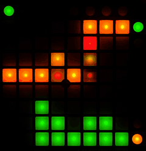</p>

Launchpad Lights turns an original Novation Launchpad Mini into a desk gadget for your Windows PC. It's a music visualiser with 13 views that react to whatever your PC is playing, a now playing display for Spotify and YouTube, a macro pad like a cheap Stream Deck, and a clock with a Pomodoro timer.

It's free, it runs from the system tray, and there's nothing to install. Download the exe and run it.

## Will it work with my Launchpad?

| Launchpad | Works? |
|---|---|
| Launchpad Mini (the original, MK1) | Yes |
| Launchpad Mini MK2 | Yes |
| Launchpad Mini MK3, Launchpad X, Launchpad Pro | No. They're full colour and use a different protocol. |
| The original Launchpad, Launchpad S | Not tested. |

An easy way to tell: if your Launchpad can only show red, green and the mixes in between (amber, orange, yellow), it's the right kind. If it can show blue or purple, it won't work.

You need Windows 10 or 11.

## Quick start

1. Plug in the Launchpad. The driver Windows installs by itself is fine, you don't need Novation's.
2. Close Ableton, Novation Components or any other music software that might be using the Launchpad.
3. Download `LaunchpadLights.exe` from the [latest release](https://github.com/leahyandco/launchpad-lights/releases/latest). Put it somewhere it can stay, like a folder in Documents.
4. Double-click it. The exe isn't code-signed, so Windows SmartScreen will probably say "Windows protected your PC" the first time. That's expected and it's fine to run it. Click **More info**, then **Run anyway**.
5. The settings window opens and an icon appears in the system tray, next to the clock. If you can't see the icon, click the **^** arrow.
6. Play some music. The Launchpad starts on the visualiser.

To have it start every time you log in, tick **Start with Windows** in Settings > General.

Closing the settings window doesn't quit it. It keeps running in the tray. To get the window back, click the tray icon. To quit, right-click the tray icon and pick **Quit**.

To remove it, untick Start with Windows, quit, then delete the exe and the `%APPDATA%\Launchpad Lights` folder.

## What it does

| Mode | What you get |
|---|---|
| Visualiser | 13 views driven by whatever the PC is playing. Auto gain keeps it readable at any volume. BPM detection, auto-cycling views, and it can follow just one app. |
| Now playing | Scrolls the current track from Spotify, browsers, Netflix or anything else that shows up in the Windows media controls. Side buttons skip and pause. |
| Macro pad | 8 pages of 64 buttons: media keys, hotkeys, commands, URLs and mic mute. Set them up in the settings window. |
| Clock | Scrolling clock, binary clock, flip clock, and a Pomodoro timer that drains the grid as it runs. |
| Test pattern | Lights every LED in every colour and shows every button press. Use it to check the hardware. |

You can unplug the Launchpad, switch from headphones to speakers, or restart Spotify. Launchpad Lights picks it back up by itself within a few seconds.

## Visualiser views

Filmed on a real Launchpad Mini playing music. Side buttons 1-6 pick the first 6 views directly, and side button 7 cycles through the rest.

<table>
<tr>
<td align="center"><br><b>1. Spectrum bars</b></td>
<td align="center">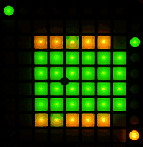<br><b>2. Mirrored</b></td>
<td align="center">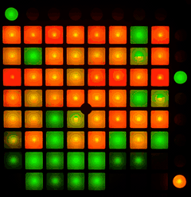<br><b>3. Spectrogram</b></td>
<td align="center">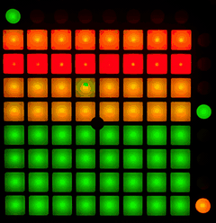<br><b>4. VU meter</b></td>
</tr>
<tr>
<td align="center">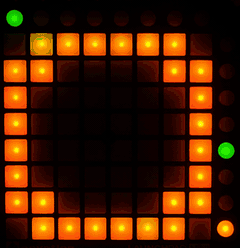<br><b>5. Beat pulse</b></td>
<td align="center">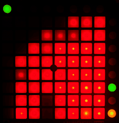<br><b>6. Fire</b></td>
<td align="center">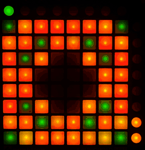<br><b>7. Radial</b></td>
<td align="center">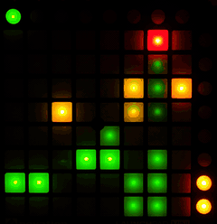<br><b>8. Fountain</b></td>
</tr>
<tr>
<td align="center">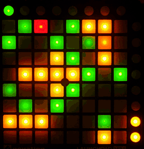<br><b>9. Sparkle</b></td>
<td align="center">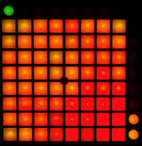<br><b>10. Plasma</b></td>
<td align="center">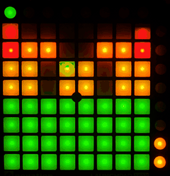<br><b>11. Centre spectrum</b></td>
<td align="center">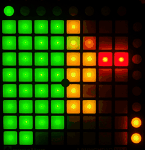<br><b>12. Horizontal bars</b></td>
</tr>
<tr>
<td align="center">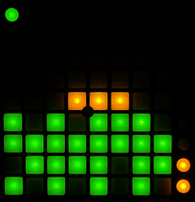<br><b>13. Bouncing dots</b></td>
<td></td><td></td><td></td>
</tr>
</table>

## Other modes

<table>
<tr>
<td align="center">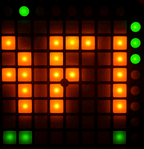<br><b>Now playing</b><br>Title in amber, artist in green.</td>
<td align="center">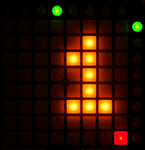<br><b>Clock</b><br>Hours, minutes and a seconds dot.</td>
<td align="center">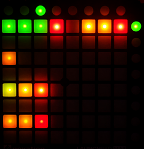<br><b>Macro pad</b><br>The default page 1 layout.</td>
</tr>
</table>

## Using the buttons

The 8 round buttons along the top pick the mode, and the one you're on is lit green. The default layout is:

| Top button | Mode |
|---|---|
| 1 | Visualiser |
| 2 | Now playing |
| 3 | Macro pad |
| 4 | Clock |
| 8 | Test pattern |

You can change these in Settings > Top buttons.

Hold top button 8 for a second to go into standby. That turns every LED off and stops listening to audio. Press any top button to wake it up. A short press on 8 just picks its mode.

The 8 round buttons down the right side do different things in each mode:

| Mode | Side buttons |
|---|---|
| Visualiser | 1-6 pick a view. 7 cycles through the other 7 views and lights amber while one of them is showing. 8 changes how fast auto gain reacts: green is low, amber medium, red high. |
| Now playing | 1 previous, 2 play/pause, 3 next. |
| Macro pad | 1-8 switch pages. Pages that have buttons on them are lit dim green. |
| Clock | 1 scrolling clock, 2 binary clock, 3 Pomodoro, 4 flip clock. In Pomodoro, 6 starts and pauses, 7 resets, and any pad also starts and pauses. |

You don't have to remember these. The settings window lists what each side button does next to the preview.

Scrolling text uses a small 3x5 font by default. It's capitals only and fits about 2 characters on screen at once. If that's hard to read, switch to the larger 5x7 font in Settings > General. The flip clock doesn't scroll at all. It shows the hours in amber, then the minutes in green, 2 seconds each.

## Settings window

<p align="center">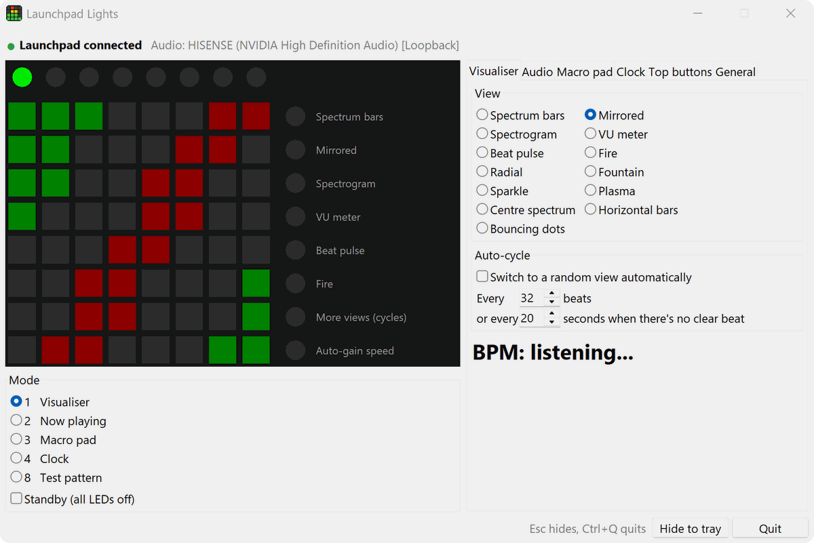</p>

The preview on the left copies the Launchpad live. Clicking it works the same as pressing the real buttons, even with nothing plugged in.

The line at the top shows whether the Launchpad is connected (and why not, if it isn't) and what audio it's listening to.

The tabs:

- **Visualiser**: pick the view, auto-cycle, live BPM.
- **Audio**: what to listen to (the whole system or one app), auto gain and how fast it reacts, gain, range, noise gate, and reset to defaults.
- **Macro pad**: click a pad and set its label, action, value and colour. Test runs the action without saving it.
- **Clock**: view, 24-hour time, Pomodoro lengths, start/pause and reset.
- **Top buttons**: which mode each top button picks.
- **General**: start with Windows, text size, and an Advanced section for the now playing scroll speed, visualiser frame rate, how long before the idle animation and what it shows, standby hold time and the MIDI port name. There are buttons to open the config folder and the logs.

Esc hides the window. Ctrl+Q quits.

Right-click the tray icon for the quick stuff: open settings, switch mode, visualiser view, auto-cycle, auto gain and its speed, standby, start with Windows and quit.

## Start with Windows

Tick Settings > General > Start with Windows, or use the tray menu. It adds an entry under your user's `Run` key in the registry that starts Launchpad Lights in the tray with `--hidden`. It doesn't need admin rights.

The entry points at wherever `LaunchpadLights.exe` was when you ticked the box. If you're running from source, it points at `pythonw.exe` in that folder's `.venv`. If you move it, start it once from the new place and it fixes the entry itself.

## Config and logs

Settings live in `%APPDATA%\Launchpad Lights\config.toml`. Launchpad Lights creates the file on first run and rewrites it whenever you change something, so any comments you add get lost. Use the settings window where you can. [config.example.toml](config.example.toml) explains every setting.

If the file has a typo, Launchpad Lights starts with the defaults and keeps the broken file as `config.bad.toml`. A value of the wrong type goes back to its default, and the log says which one.

Logs go to `%APPDATA%\Launchpad Lights\logs\launchpad-lights.log`. The file rolls over at 1 MB and the last 3 are kept. It records the Launchpad connecting and disconnecting, audio device changes, mode switches and errors.

## Something not working?

- **"Windows protected your PC"**: that's SmartScreen. It shows up because the exe isn't code-signed, and it's fine to get past it. Click **More info**, then **Run anyway**.
- **"Launchpad not found"**: check it's plugged in, or try another USB port or cable. The line under it lists the MIDI devices Windows can see. If the Launchpad isn't in that list, Windows hasn't picked it up.
- **"Launchpad is in use by another app"**: close Ableton, Novation Components or your DAW. Launchpad Lights connects by itself once the Launchpad is free.
- **"Launchpad Lights is already running"**: it's in the tray. Click the **^** arrow next to the clock.
- **The visualiser doesn't move**: check the line at the top of the settings window shows the speakers or headphones you're actually using. If not, make them the Windows default. If the bars move but never fill up, raise Gain in Settings > Audio.
- **Now playing shows nothing**: it only works with apps that show up in the Windows volume flyout's media controls.

For everything else, see [Troubleshooting](docs/troubleshooting.md).

## Run from source

You only need this if you want to change the code. You need [uv](https://docs.astral.sh/uv/). It installs Python 3.12 and everything else for you.

```
git clone https://github.com/leahyandco/launchpad-lights.git
cd launchpad-lights
uv run launchpad-lights
```

The first run downloads Python and the dependencies, then the settings window opens.

| Command | What it does |
|---|---|
| `uv run launchpad-lights` | Tray icon and settings window. |
| `uv run launchpad-lights --hidden` | Tray icon only. Start with Windows uses this. |
| `uv run launchpad-lights --no-gui` | No window or tray icon. Ctrl+C to quit. |
| `uv run launchpad-lights --test` | Hardware test. Lights every LED and prints every button press. |
| `uv run launchpad-lights --simulate` | Draws the Launchpad in the terminal instead of using the device. Keys 1-8 are the top buttons, a-h are the side buttons and space toggles standby. |
| `uv run launchpad-lights --list-ports` | Lists MIDI ports and audio devices. |
| `uv run launchpad-lights --mode clock` | Starts in a specific mode. |
| `uv run launchpad-lights --config path\to\config.toml` | Uses a different config file. |
| `uv run pytest` | Runs the tests. |

`--hidden`, `--mode` and `--config` work on the exe too, like `LaunchpadLights.exe --mode clock`. The others print to a terminal, so they only work from source.

`flash_test.py` is a quick check that the Launchpad responds, without the rest of the app: `uv run flash_test.py`.

To build the exe yourself, run this from the repo folder. It ends up in `dist\LaunchpadLights.exe`.

```
powershell -ExecutionPolicy Bypass -File packaging\build.ps1
```

## Docs

- [Macro pad](docs/macro-pad.md): actions, key names, colours and examples.
- [Audio](docs/audio.md): capture, gain, single-app capture, BPM and auto-cycle.
- [Troubleshooting](docs/troubleshooting.md)
- [Writing a mode](docs/writing-a-mode.md): adding your own mode.
- [Changelog](CHANGELOG.md)

## Feedback and contributing

Issues and feedback are welcome. If something's broken, confusing or missing, or you've got an idea, [open an issue](https://github.com/leahyandco/launchpad-lights/issues/new/choose) and let me know. Questions, and what you're using it for, go in [Discussions](https://github.com/leahyandco/launchpad-lights/discussions).

Pull requests are welcome too. If it's something big, open an issue first so we can talk about it.

## Licence

MIT. See [LICENSE](LICENSE).

Maintained by [Leahy & Co](https://leahyandco.com.au/?utm_source=github). Need something like this built? I take on paid work.
